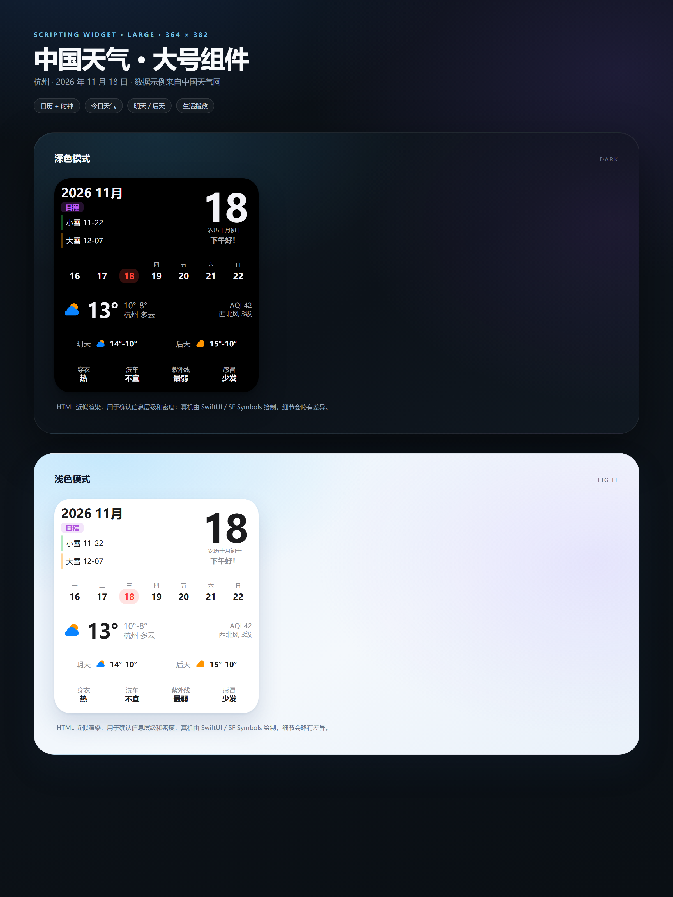
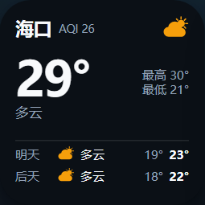
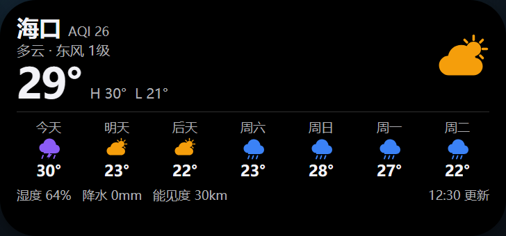
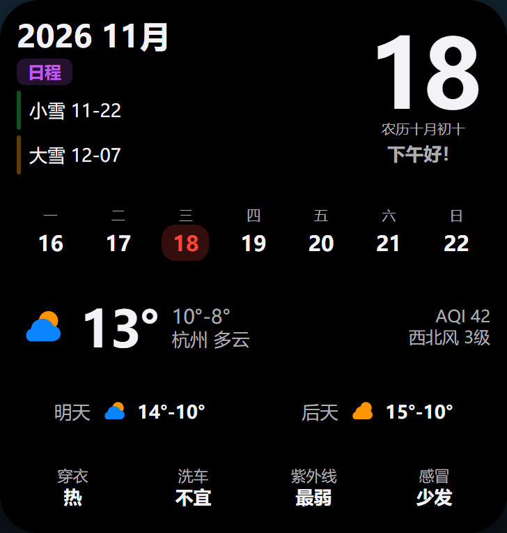
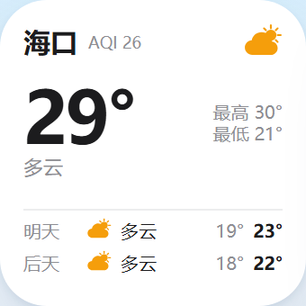
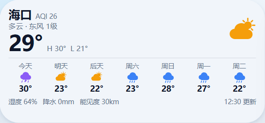
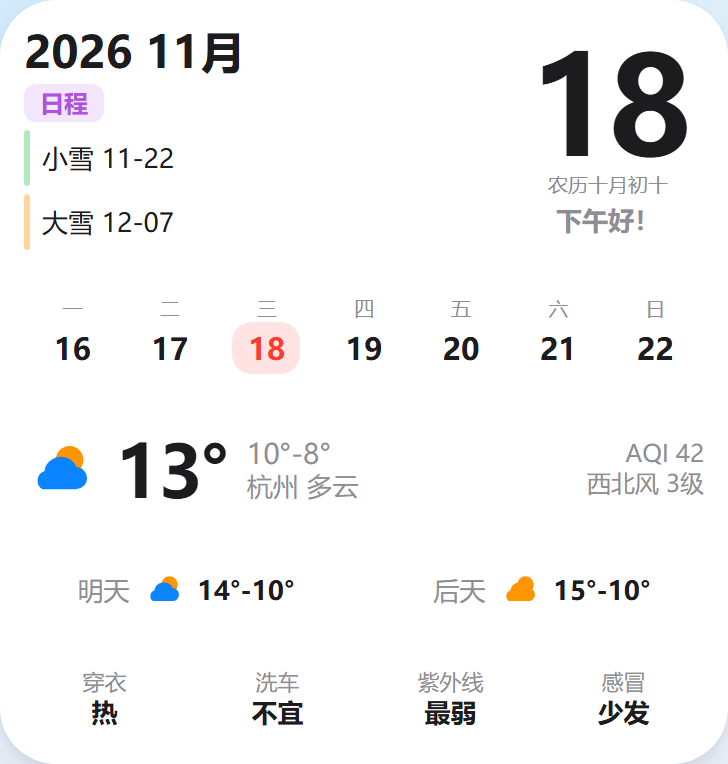

# 中国天气 · Scripting 小组件

把原来的 Egern 天气模块改写成 **Scripting App** 的 TSX 小组件。数据来自中国天气网，不需要 API Key。

支持小号、中号、大号，以及锁屏圆形 / 矩形 / 行内组件；深色和浅色模式都做了适配。

大号按原始 Egern 模块的结构重做：左侧是年月、日程和最近两个节气/节日，中间暂时留空，右侧是大号日期、农历（当天是节气时一并显示）和问候语；下方依次是本周日期、今日天气、明天/后天和生活指数。整体间距按组件高度均匀分布，不会在底部留出大片空白。



## 直接导入

推荐从 Release 下载（文件名是 ASCII，Safari 下载更稳）：

**[下载 ChinaWeatherWidget.scripting](https://github.com/SmallMr/Scripting-WeatherWidget/releases/latest/download/ChinaWeatherWidget.scripting)**

也可以直接下载仓库里的 [`中国天气小组件.scripting`](https://github.com/SmallMr/Scripting-WeatherWidget/raw/main/%E4%B8%AD%E5%9B%BD%E5%A4%A9%E6%B0%94%E5%B0%8F%E7%BB%84%E4%BB%B6.scripting)。

1. 下载上面的 `.scripting` 文件。
2. 在 iPhone 的“文件”里点开这个 `.scripting` 文件，选择用 **Scripting** 打开。
3. 打开脚本后运行一次 `index.tsx`，可以预览小 / 中 / 大号。
4. 回到桌面：长按空白处 → 左上角 `+` → 搜索 **Scripting** → 选择尺寸 → 添加。
5. 长按组件 → 编辑小组件 → 选择「中国天气小组件」。

> 如果不想用 `.scripting`，也可以直接下载仓库 ZIP，把 `script.json`、`index.tsx`、`widget.tsx` 放进 Scripting 项目。

全部界面只用到常规的 SwiftUI 组件和 SF Symbols，没有依赖 Canvas 之类的额外能力。

## 远程导入 / 更新

Scripting 支持从 URL 导入脚本，也支持在 `script.json` 里配置远程更新源。本项目的远程包地址是：

```text
https://raw.githubusercontent.com/SmallMr/Scripting-WeatherWidget/main/ChinaWeatherWidget.scripting
```

在 Scripting 的「更多 → URL Scheme → 导入脚本 → 脚本 URL」里粘贴这个地址即可远程导入。也可以让 Scripting 生成一次性导入链接：

```text
https://www.scripting.fun/import_scripts/?urls=["https://raw.githubusercontent.com/SmallMr/Scripting-WeatherWidget/main/ChinaWeatherWidget.scripting"]
```

把上面的 JSON 数组做 URL 编码后再放进 `urls` 参数即可；`scripting://import_scripts?urls=...` 也是同样的格式。

`script.json` 已配置：

```json
"remoteResource": {
  "url": "https://github.com/SmallMr/Scripting-WeatherWidget"
}
```

默认**不会自动覆盖本地版本**。如果希望 Scripting 定期检查并自动更新，可以再加：

```json
"autoUpdateInterval": 86400
```

单位是秒。自动更新会重新下载并执行远程代码，介意供应链风险就不要开启，或者把 `remoteResource.url` 固定到某个 tag，例如 `https://github.com/SmallMr/Scripting-WeatherWidget/tree/v1.2.0`。

## 预览

| 小号 | 中号 | 大号 |
| --- | --- | --- |
|  |  |  |

浅色模式：

| 小号 | 中号 | 大号 |
| --- | --- | --- |
|  |  |  |

预览是按组件真实尺寸（170 / 364 / 382pt）和真实天气数据做的 HTML 近似渲染；真机上由 iOS 用 SF Symbols 和系统字体绘制，细节会略有差异。

## 城市参数

在「编辑小组件」的参数里填：

```text
杭州
```

或者带问候语名字的 JSON：

```json
{"city":"杭州","name":"你的昵称"}
```

不填时使用 `widget.tsx` 顶部的 `DEFAULT_CITY`，默认值是 `杭州`（浙江）。

常用城市内置了编码，其他城市会自动请求中国天气网的搜索接口。找不到城市时会显示错误卡片，不会静默回退到北京。

## 数据与刷新

- 实况：`https://d1.weather.com.cn/weather_index/{城市编码}.html`
- 7 天预报：`https://www.weather.com.cn/weather/{城市编码}.shtml`
- 城市搜索：`https://toy1.weather.com.cn/search?cityname={城市名}`

农历和节气都在本地计算，不联网：农历使用 1900–2100 年的标准农历表（含闰月），节气使用 1900 年起的分钟偏移近似算法。

请求超时 10 秒，刷新策略是 30 分钟后请求下一次。iOS 的 WidgetKit 会自行决定实际刷新时刻，可能晚于 30 分钟。

这是网页数据解析，不是官方开放 API。中国天气网改版后，字段可能需要跟着调整。

## 隐私与安全

原 Egern 模块引用的 `WeatherWdg.js`（约 105 KB）已检查：

- 只访问 `toy1.weather.com.cn`、`d1.weather.com.cn`、`www.weather.com.cn` 三个 HTTPS 域名。
- 只有 3 处 GET，没有 POST、上传、WebSocket、埋点、`eval` 或动态代码。
- 不读取剪贴板、通讯录、照片、文件、钥匙串、设备标识。
- **不使用定位**，城市来自参数，默认「杭州」。

会暴露给中国天气网的只有：公网 IP、查询的城市名，以及伪装成 iPhone Safari 的 User-Agent / Referer。这是在线天气查询无法避免的。

原模块的主要风险是供应链：`script_url` 指向 GitHub 的 `main` 分支，没有固定版本或哈希，作者以后改 JS，Egern 下次刷新就可能执行新代码。本仓库的远程地址是自己的仓库，只有仓库所有者能推送，风险主要来自账号被盗；仍建议固定到 tag，而不是跟随 `main`。天气请求使用 `credentials: "omit"`，不携带 Cookie。

本项目是第三方改写，不是中国天气网或 Scripting 官方项目。不能替中国天气网或 GitHub 账号本身背书。

## 源码

```text
script.json               Scripting 项目描述
index.tsx                 说明页 + 尺寸预览
widget.tsx                小组件本体
中国天气小组件.scripting   可直接导入的打包文件
preview/                  预览图片和 HTML
```

## 已验证 / 未验证

- 已通过 TSX 语法编译和 TypeScript 类型自检。
- 已用真实接口验证杭州、慈溪的实况、7 天预报、生活指数解析。
- 大号已按原始 Egern 布局重新生成预览图：头部中间暂时留空，明天/后天与生活指数居中，生活指数去掉了底色和图标；预览是 HTML 近似渲染。
- 尚未在真实 iPhone 的 Scripting 宿主里验证最终字体、SF Symbols 和间距；安装后如果排版有偏差，可以按真机截图继续调。

## 致谢

原始 Egern 模块：`IBL3ND/module` 的 `WeatherWdg.yaml` 与 `WeatherWdg.js`。数据和页面结构归中国天气网所有。
